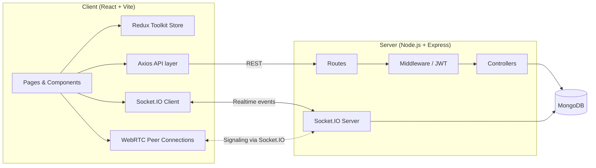

# Meet-Sphere

> A Google Meet-inspired video conferencing web application built with the MERN stack, Socket.IO, and WebRTC.


> **Project status: under active development.** Several features are partially implemented or still being tested. See [Key Features](#4-key-features) and [Current Limitations](#13-current-limitations) for an honest breakdown.

---

## Table of Contents

1. [Project Title](#meet-sphere)
2. [Project Overview](#2-project-overview)
3. [Objectives](#3-objectives)
4. [Key Features](#4-key-features)
5. [Technology Stack](#5-technology-stack)
6. [Project Architecture](#6-project-architecture)
7. [Project Folder Structure](#7-project-folder-structure)
8. [Prerequisites](#8-prerequisites)
9. [Installation and Setup](#9-installation-and-setup)
10. [Environment Configuration](#10-environment-configuration)
11. [How to Run the Application](#11-how-to-run-the-application)
12. [Application Workflow](#12-application-workflow)
13. [Current Limitations](#13-current-limitations)
14. [Future Enhancements](#14-future-enhancements)
15. [Security Notes](#15-security-notes)
16. [Author](#16-author)
17. [License](#17-license)

---

## 2. Project Overview

**Meet-Sphere** is a full stack video conferencing web application inspired by Google Meet. It is designed to let users:

- Register and log in to an account
- Create a meeting or join one using a meeting code
- Communicate with other participants in a meeting
- Manage meeting interactions, such as admitting or denying participants as a host

The project is split into a **React (Vite) client** and a **Node.js/Express server**, connected through REST APIs (Axios) and real-time events (Socket.IO).

---

## 3. Objectives

- Build a Google Meet-style meeting experience with a host-controlled admission flow.
- Implement secure, token-based authentication using JWT.
- Use Socket.IO for real-time signaling, participant updates, and messaging.
- Use WebRTC for peer-to-peer audio/video communication.
- Manage application state predictably using Redux Toolkit.
- Persist users, meetings, participants, and messages using MongoDB and Mongoose.

---

## 4. Key Features

### Status legend

| Label | Meaning |
|---|---|
| ✅ **Implemented** | Present in the codebase and working as intended |
| 🟡 **Partial / Under testing** | Code exists, but behavior is incomplete or not fully tested |
| 🔲 **Planned** | Not yet implemented |

> **Note:** Statuses below reflect the intended scope of the project at the time of writing. Each item should be re-verified against the source code and updated as development continues. Items marked 🟡 should not be considered production-ready.

### Current feature set

| Feature | Status | Notes |
|---|---|---|
| User registration and login | 🟡 Partial / Under testing | Auth flow with validation via `express-validator`. *(TODO: confirm end-to-end behavior)* |
| JWT-based authentication | 🟡 Partial / Under testing | Token infrastructure present. *(TODO: confirm protected routes and token handling)* |
| Meeting dashboard | 🟡 Partial / Under testing | Located under `client/src/page/Dashboard/`. |
| Meeting creation and meeting ID generation | 🟡 Partial / Under testing | |
| Join a meeting using a meeting code | 🟡 Partial / Under testing | |
| Host and participant roles | 🟡 Partial / Under testing | |
| Join request and host admission workflow | 🟡 Partial / Under testing | Edge cases still being worked on. |
| Waiting screen for users awaiting admission | 🟡 Partial / Under testing | |
| Deny join requests | 🟡 Partial / Under testing | |
| Real-time messaging (Socket.IO) | 🟡 Partial / Under testing | Socket infrastructure exists; chat functionality is not confirmed complete. |
| WebRTC peer connection infrastructure | 🟡 Partial / Under testing | Audio/video connection reliability is still being improved. |
| Microphone and camera controls | 🟡 Partial / Under testing | |
| Participant panel | 🟡 Partial / Under testing | |
| Camera status indicators | 🟡 Partial / Under testing | |
| Redux Toolkit state management | 🟡 Partial / Under testing | Store, slices, and actions are organized under `client/src/redux/`. |
| MongoDB/Mongoose models | 🟡 Partial / Under testing | Models for users, meetings, participants, and meeting messages. |
| Screen sharing | 🔲 Planned | |
| File uploads (Multer / Cloudinary) | 🔲 Planned | Libraries are installed but file upload is **not** claimed as a working feature. |

---

## 5. Technology Stack

| Layer | Technology | Purpose |
|---|---|---|
| **Frontend** | React.js | UI library |
| | Vite | Build tool and dev server |
| | JavaScript | Programming language |
| | Bootstrap 5 | Styling and layout |
| | Bootstrap Icons, React Icons | Icons |
| | React Router DOM | Client-side routing |
| | Redux Toolkit, React Redux | State management |
| | Axios | HTTP requests to the API |
| | Socket.IO Client | Real-time communication |
| | CSS3 | Custom styling |
| **Backend** | Node.js | Runtime environment |
| | Express.js | Web framework |
| | MongoDB | Database |
| | Mongoose | ODM for MongoDB |
| | Socket.IO | Real-time events and signaling |
| | JSON Web Token (JWT) | Authentication tokens |
| | bcryptjs | Password hashing |
| | dotenv | Environment variable loading |
| | CORS | Cross-origin request handling |
| | express-validator | Request validation |
| | Multer | File upload middleware *(installed; upload feature not confirmed)* |
| | Cloudinary | Media storage *(installed; integration not confirmed)* |
| **Browser APIs** | WebRTC | Peer-to-peer audio/video |

---

## 6. Project Architecture



**How it fits together**

- **REST API (Axios → Express):** registration, login, and meeting data operations.
- **Socket.IO:** join requests, host admission/denial, participant updates, messaging, and WebRTC signaling.
- **WebRTC:** audio/video streams are intended to flow peer-to-peer between participants, with the server only handling signaling.
- **MongoDB:** stores users, meetings, participants, and meeting messages.

---

## 7. Project Folder Structure

```text
Industry project/
├── chat-application/
└── meet-sphere/
    ├── client/
    │   ├── public/
    │   ├── src/
    │   │   ├── api/
    │   │   ├── assets/
    │   │   ├── components/
    │   │   ├── page/
    │   │   │   ├── Dashboard/
    │   │   │   ├── LoginPage/
    │   │   │   ├── Meeting/
    │   │   │   └── Register/
    │   │   ├── redux/
    │   │   │   ├── action/
    │   │   │   ├── slice/
    │   │   │   └── store.js
    │   │   ├── socket/
    │   │   └── utils/
    │   ├── package.json
    │   └── README.md
    └── server/
        ├── config/
        ├── controllers/
        ├── middleware/
        ├── models/
        ├── routes/
        ├── socket/
        ├── utils/
        ├── app.js
        └── package.json
```

> The `chat-application/` folder is a separate project directory and is not documented as part of Meet-Sphere.

---

## 8. Prerequisites

Make sure the following are installed on your Windows machine:

- **Node.js and npm** — [nodejs.org](https://nodejs.org/) (LTS version recommended)
- **MongoDB** — either a local MongoDB installation or a [MongoDB Atlas](https://www.mongodb.com/atlas) connection string
- **Git** — [git-scm.com](https://git-scm.com/)
- **A modern browser** (Chrome, Edge, or Firefox) with camera and microphone permissions enabled

Verify your installations in Command Prompt or PowerShell:

```bash
node -v
npm -v
git --version
```

---

## 9. Installation and Setup

### Step 1 — Clone the repository

```bash
git clone <your-repository-url>
cd "Industry project"
```

> Replace `<your-repository-url>` with your actual repository URL. *(Placeholder — no repository URL is assumed here.)*

### Step 2 — Install backend dependencies

```bash
cd meet-sphere/server
npm install
```

### Step 3 — Install frontend dependencies

Open a **new** terminal window:

```bash
cd meet-sphere/client
npm install
```

### Step 4 — Configure environment variables

Create a `.env` file inside `meet-sphere/server/` (see [Environment Configuration](#10-environment-configuration)).

---

## 10. Environment Configuration

### Backend `.env.example`

Create a file named `.env.example` in `meet-sphere/server/` as a template for other developers. It must contain **placeholders only**:

```env
PORT=5000
MONGODB_URI=your_mongodb_connection_string
JWT_SECRET=your_secure_jwt_secret
CLIENT_URL=http://localhost:5173
```

Then create your real `.env` file from it (on Windows):

```bash
copy .env.example .env
```

and replace the placeholder values with your own.

> ⚠️ **Verify variable names before use.** The names above are a **template and are not confirmed** against the source code. Before running the project, check that they match what the backend actually reads. In particular, inspect:
>
> - `server/app.js` (port, CORS/client URL, Socket.IO setup)
> - the database config file, e.g. `server/config/dbConnect.js` (MongoDB connection variable)
> - the authentication controller (JWT secret variable)
>
> Update `.env.example` so it matches the real `process.env.*` names used in your code.

### Frontend configuration

The frontend must know where the backend is running. Check the following folders in `meet-sphere/client/src/`:

| What to configure | Where to look |
|---|---|
| **Axios base URL** (REST API) | `src/api/` — find where the Axios instance is created and set its base URL to your backend address (e.g. your local server URL and port). |
| **Socket.IO server URL** | `src/socket/` — find where the Socket.IO client is initialized and set it to the same backend address. |

> These may be hard-coded or read from a Vite environment variable (variables prefixed with `VITE_`). **Check the existing source to see which approach is used** and update it accordingly. The exact variable names are intentionally not specified here.

Make sure the backend's allowed CORS origin matches the URL where the frontend runs (Vite's default is `http://localhost:5173`).

---

## 11. How to Run the Application

The frontend and backend run as **two separate processes**, so you need **two terminals**.

**Terminal 1 — Backend**

```bash
cd meet-sphere/server
npm run dev
```

**Terminal 2 — Frontend**

```bash
cd meet-sphere/client
npm run dev
```

Then open the URL printed by Vite in your terminal (typically `http://localhost:5173`) in your browser, and allow camera and microphone access when prompted.

> If `npm run dev` fails, check the `scripts` section of each `package.json` to confirm the available commands.

---

## 12. Application Workflow

The intended user journey is:

| # | Step | Status |
|---|---|---|
| 1 | Register a new account | 🟡 Under testing |
| 2 | Log in to the application | 🟡 Under testing |
| 3 | Access the dashboard | 🟡 Under testing |
| 4 | Create a meeting, or enter an existing meeting ID | 🟡 Under testing |
| 5 | The host enters the meeting | 🟡 Under testing |
| 6 | A new participant requests permission to join and sees a waiting screen | 🟡 Under testing |
| 7 | The host admits or denies the participant | 🟡 Under testing — edge cases remain |
| 8 | Admitted participants access the meeting interface | 🟡 Under testing |
| 9 | Participants use available meeting controls (mic, camera) and messaging | 🟡 Partial — WebRTC reliability and chat completeness are still in progress |

---

## 13. Current Limitations

This project is **still under development**. Known limitations include:

- WebRTC audio/video connections may not be reliable in all situations.
- Microphone and camera behavior is not fully completed or tested.
- The Google Meet-style join notification needs improvement.
- Participant synchronization and admission edge cases are not fully handled.
- Real-time chat may be incomplete.
- Screen sharing is not available.
- Meeting-level security and access control are limited.
- No automated tests or production deployment are included.
- Responsive design and error handling need improvement.
- Multer and Cloudinary are installed, but file upload functionality is not claimed to be working.

---

## 14. Future Enhancements

- [ ] Improve WebRTC connection reliability
- [ ] Complete and test microphone and camera behavior
- [ ] Improve the Google Meet-style join notification
- [ ] Improve participant synchronization and admission edge cases
- [ ] Complete any unfinished real-time chat functionality
- [ ] Add screen sharing
- [ ] Add meeting security and access control
- [ ] Add automated testing
- [ ] Prepare production deployment
- [ ] Improve responsive design and error handling

---

## 15. Security Notes

- **Never commit your `.env` file.** Make sure `.env` is listed in `.gitignore`.
- Use only placeholders in `.env.example`. Do not put real credentials, API keys, database passwords, or JWT secrets in version control.
- Use a long, random value for `JWT_SECRET`.
- Passwords are intended to be hashed with `bcryptjs` before storage. *(TODO: confirm in the authentication controller.)*
- Restrict CORS to your actual frontend origin.
- If any secret is ever committed by accident, rotate it immediately.
- This project has **not** undergone a security audit and should not be used in production in its current state.

---

## 16. Author

**Manisha Nahak**

- GitHub: [nahakmanisha18-cyber](https://github.com/nahakmanisha18-cyber)
- LinkedIn: [Manisha Nahak](https://www.linkedin.com/in/manisha-nahak-8809883a2/)
- Repository: [Meet-Sphere](https://github.com/nahakmanisha18-cyber/meet-sphere)
  
*(Placeholders — replace with your own links.)*

---

## 17. License

No open-source license has been configured for this project yet. All rights are reserved by the author until a license is added.
